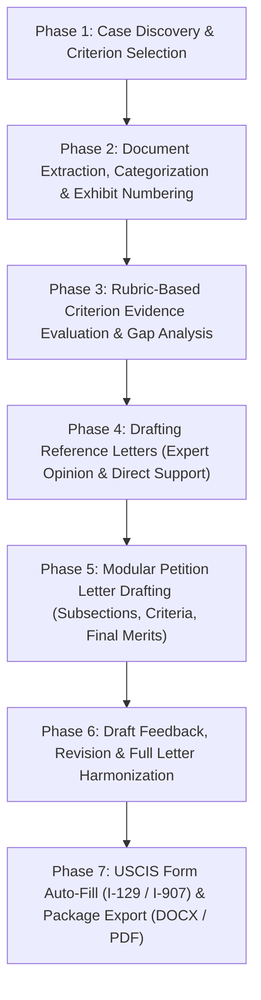

# Meta-Skill: Preparing an O-1A, O-1B, or EB-1A Visa Application with WeVisa

This meta-skill orchestrates all modular skills in the WeVisa platform (`https://wevisa.ai/mcp` and `https://wevisa.ai/api/v1/skills`) to take an **O-1A**, **O-1B (Arts or MPTV)**, or **EB-1A** extraordinary ability case from raw client documents to a complete, rubric-audited, filing-ready USCIS submission package.

## Companion Modular Skills
- [`o1a-criteria-drafting-and-review`](../o1a-criteria-drafting-and-review/SKILL.md) — O-1A 8 criteria (`8 C.F.R. § 214.2(o)(3)(iii)`), Petitioner, Beneficiary, and Itinerary.
- [`o1b-criteria-drafting-and-review`](../o1b-criteria-drafting-and-review/SKILL.md) — O-1B Arts & MPTV 7 criteria (`8 C.F.R. § 214.2(o)(3)(iv)-(v)`).
- [`eb1a-criteria-and-final-merits`](../eb1a-criteria-and-final-merits/SKILL.md) — EB-1A 11 Step One criteria (`8 C.F.R. § 204.5(h)(3)`), Part 2 Final Merits Determination (*Kazarian* Step Two), and Continuation of Work (`INA § 203(b)(1)(A)(ii)-(iii)`).
- [`reference-letter-drafting`](../reference-letter-drafting/SKILL.md) — Independent Expert Opinion & Direct Support letters.
- [`document-review-and-draft-feedback`](../document-review-and-draft-feedback/SKILL.md) — Document extraction, categorization, exhibit numbering (`A.1`, `B.1`), rubric evaluation, draft feedback, and case readiness audits.
- [`forms-and-package-export`](../forms-and-package-export/SKILL.md) — Form I-129 / I-907 auto-filling, PDF generation, and Word (`.docx`) / PDF export.

---

## Injecting Custom Prompts & Skills (`custom_prompt` & `additional_prompts`)

All LLM-powered MCP tools and REST API endpoints accept two optional fields that are pasted directly into the LLM execution context alongside the server's internal rubrics:
- `custom_prompt` (`str`): A single custom prompt, firm style rule, or case-specific instruction.
- `additional_prompts` (`str | List[str]`): One or more arbitrary skill prompts, legal arguments, or editorial rules to inject into the context.

Example payload:
```json
{
  "criterion_key": "eb1a_contribution",
  "beneficiary_name": "Dr. Jane Doe",
  "evidence_title": "SparseFlow Distributed Inference Engine",
  "documents": [{"id": 1, "title": "US Patent 11,402,991", "text": "..."}],
  "custom_prompt": "Emphasize quantifiable latency reductions and adoption by Fortune 500 enterprises.",
  "additional_prompts": [
    "Firm Style Rule: Cite all exhibits in parentheticals at the end of sentences rather than mid-sentence.",
    "Frame technical metrics for a generalist USCIS adjudicator at the Nebraska Service Center."
  ]
}
```

---

## End-to-End Agent Workflow for Preparing an O-1 or EB-1 Application



### Phase 1: Case Discovery & Criterion Selection
1. **Identify the Visa Classification**:
   - `o1-a`: Extraordinary Ability in Sciences, Education, Business, or Athletics (`Form I-129`).
   - `o1-b`: Extraordinary Ability in the Arts or Extraordinary Achievement in Motion Picture/Television (`Form I-129`).
   - `eb1-a`: Alien of Extraordinary Ability Immigrant Petition (`Form I-140`, *Kazarian* Two-Step).
2. **List Criteria & Statutory Citations**:
   - **MCP**: `tool_list_criteria(visa_type="eb1-a")` / **API**: `GET https://wevisa.ai/api/v1/skills/criteria?visa_type=eb1-a`

### Phase 2: Document Extraction, Categorization & Exhibit Numbering
1. **Generate Document Titles, Summaries & Suggested Categories**:
   - **MCP**: `tool_analyze_document(text="...", filename="...", visa_type="eb1-a", custom_prompt=...)` / **API**: `POST /api/v1/skills/documents/analyze`
2. **Auto-Map Documents to Criteria & Subsections**:
   - **MCP**: `tool_auto_categorize_documents(visa_type="eb1-a", documents=[...], additional_prompts=...)` / **API**: `POST /api/v1/skills/documents/auto-categorize`
3. **Assign Exhibit Numbers (`A.1`, `A.2`, `B.1`, ...)**:
   - **MCP**: `tool_assign_exhibit_numbers(documents=[...], visa_type="eb1-a")` / **API**: `POST /api/v1/skills/documents/assign-exhibits`

### Phase 3: Rubric-Based Criterion Evidence Evaluation & Readiness Audit
1. **Evaluate Each Candidate Criterion Against Its Official Server-Side Rubric**:
   - **MCP**: `tool_evaluate_criterion_evidence(criterion_key="eb1a_award", beneficiary_name="...", documents=[...], evidence_title="...", custom_prompt=..., additional_prompts=...)`
   - **API**: `POST /api/v1/skills/review/evaluate-criterion`
   - Inspect `overall_rating` (`STRONG`, `MEDIUM`, `WEAK`, `DO_NOT_CLAIM`), `element_findings`, `claim_to_evidence_table`, `rfe_and_denial_risks`, and `missing_evidence`.
2. **Run a Holistic Case Readiness Check**:
   - **MCP**: `tool_evaluate_case_readiness(visa_type="eb1-a", beneficiary_name="...", criteria_evaluations=[...], field_of_endeavor="...", custom_prompt=...)`
   - **API**: `POST /api/v1/skills/review/case-readiness`

### Phase 4: Drafting Reference Letters (Expert Opinion & Direct Support)
1. **Select Supporting Documents for Each Recommender**:
   - **MCP**: `tool_suggest_reference_letter_documents(visa_type="eb1-a", beneficiary_name="...", reference_name="...", documents=[...], letter_variant="expert")`
   - **API**: `POST /api/v1/skills/reference-letters/suggest-documents`
2. **Draft Independent Expert Opinion & Direct Support Letters**:
   - **MCP**: `tool_draft_reference_letter(visa_type="eb1-a", letter_variant="expert" | "support", custom_prompt=..., additional_prompts=..., ...)`
   - **API**: `POST /api/v1/skills/reference-letters/draft`
3. **Audit Reference Letter Drafts**:
   - **MCP**: `tool_give_draft_feedback(draft_text=..., section_type="reference_letter", visa_type="eb1-a", custom_prompt=...)`
   - **API**: `POST /api/v1/skills/review/feedback`

### Phase 5: Modular Attorney Petition Letter Drafting
Agents can draft the attorney cover letter piece-by-piece or in one orchestrated pass, passing `custom_prompt` or `additional_prompts` to any step:
1. **Draft Petitioner / Continuation of Work Section**:
   - **MCP**: `tool_draft_petitioner_section(visa_type="eb1-a", beneficiary_name="...", documents=[...], custom_prompt=...)`
   - **API**: `POST /api/v1/skills/draft/petitioner`
2. **Draft Beneficiary Background Overview**:
   - **MCP**: `tool_draft_beneficiary_section(visa_type="eb1-a", beneficiary_name="...", documents=[...], custom_prompt=...)`
   - **API**: `POST /api/v1/skills/draft/beneficiary`
3. **Draft Criterion Subsections, Intros & Conclusions**:
   - Draft individual accomplishments: `tool_draft_evidence_subsection` (`POST /api/v1/skills/draft/subsection`)
   - Draft criterion intro: `tool_draft_criterion_intro` (`POST /api/v1/skills/draft/criterion-intro`)
   - Draft criterion conclusion: `tool_draft_criterion_conclusion` (`POST /api/v1/skills/draft/criterion-conclusion`)
   - Or draft an entire criterion section at once: `tool_draft_criterion_section` (`POST /api/v1/skills/draft/criterion-section`)
4. **Draft EB-1A Part 2: Final Merits Determination (*Kazarian* Step Two)** *(for EB-1A)*:
   - **MCP**: `tool_draft_eb1a_final_merits(beneficiary_name="...", criteria_summaries=[...], context="...", custom_prompt=...)`
   - **API**: `POST /api/v1/skills/draft/eb1a-final-merits`
5. **Draft Itinerary of Events** *(for O-1A / O-1B)*:
   - **MCP**: `tool_draft_itinerary_section(visa_type="o1-a", beneficiary_name="...", documents=[...], custom_prompt=...)`
   - **API**: `POST /api/v1/skills/draft/itinerary`
6. **Draft Letter Introduction & Conclusion (or Full Letter)**:
   - **MCP**: `tool_draft_letter_intro`, `tool_draft_letter_conclusion`, or `tool_draft_full_attorney_letter`
   - **API**: `POST /api/v1/skills/draft/letter-intro`, `POST /api/v1/skills/draft/letter-conclusion`, or `POST /api/v1/skills/draft/full-letter`

### Phase 6: Draft Critique, Revision & Section Harmonization
1. **Review Any Section Against Official Rubrics**:
   - **MCP**: `tool_give_draft_feedback(draft_text="...", section_type="criterion_section", visa_type="eb1-a", criterion_key="eb1a_role", custom_prompt=...)`
   - **API**: `POST /api/v1/skills/review/feedback`
2. **Apply Targeted Attorney Edits**:
   - **MCP**: `tool_edit_draft_with_instruction(highlighted_text="...", instruction="...", context="...", custom_prompt=...)`
   - **API**: `POST /api/v1/skills/draft/edit-text`
3. **Harmonize Transitions Across Sections**:
   - **MCP**: `tool_harmonize_letter_section(target_section="...", previous_sections=[...], following_sections=[...], visa_type="eb1-a", custom_prompt=...)`
   - **API**: `POST /api/v1/skills/draft/harmonize-section`

### Phase 7: USCIS Form Auto-Fill & Package Export
1. **Auto-Fill & Generate Form I-129 / I-907 PDFs**:
   - **MCP**: `tool_autofill_uscis_form(documents=[...], custom_prompt=...)` -> `tool_fill_uscis_form_pdf(form_data={...}, include_i907=True)`
   - **API**: `POST /api/v1/skills/forms/autofill` -> `POST /api/v1/skills/forms/fill-pdf`
2. **Export Petition Letter & Reference Letters to Word (`.docx`) and PDF**:
   - **MCP**: `tool_export_draft_to_docx(markdown_text="...", output_path="...")` and `tool_export_draft_to_pdf(markdown_text="...", output_path="...")`
   - **API**: `POST /api/v1/skills/export/docx` and `POST /api/v1/skills/export/pdf`

---

## Complete REST API & MCP Tool Reference Table

| Capability | MCP Tool Name | REST API Endpoint | Accepts `custom_prompt` / `additional_prompts` |
| :--- | :--- | :--- | :---: |
| List supported visas (`o1-a`, `o1-b`, `eb1-a`) | `tool_list_visas` | `GET /api/v1/skills/visas` | No |
| List criteria for a visa | `tool_list_criteria` | `GET /api/v1/skills/criteria` | No |
| Extract text from PDF/DOCX/image | `tool_extract_document` | `POST /api/v1/skills/documents/extract` | No |
| Analyze & categorize a document | `tool_analyze_document` | `POST /api/v1/skills/documents/analyze` | **Yes** |
| Suggest subsections & docs for a criterion | `tool_suggest_documents_for_criterion` | `POST /api/v1/skills/documents/suggest-for-criterion` | **Yes** |
| Auto-categorize case documents across criteria | `tool_auto_categorize_documents` | `POST /api/v1/skills/documents/auto-categorize` | **Yes** |
| Assign exhibit numbers (`A.1`, `B.1`) & index | `tool_assign_exhibit_numbers` | `POST /api/v1/skills/documents/assign-exhibits` | No |
| Evaluate criterion evidence against rubric | `tool_evaluate_criterion_evidence` | `POST /api/v1/skills/review/evaluate-criterion` | **Yes** |
| Give legal & editorial feedback on a draft | `tool_give_draft_feedback` | `POST /api/v1/skills/review/feedback` | **Yes** |
| Holistic case readiness & RFE risk audit | `tool_evaluate_case_readiness` | `POST /api/v1/skills/review/case-readiness` | **Yes** |
| Draft a single evidence subsection + review | `tool_draft_evidence_subsection` | `POST /api/v1/skills/draft/subsection` | **Yes** |
| Draft criterion introduction paragraph | `tool_draft_criterion_intro` | `POST /api/v1/skills/draft/criterion-intro` | **Yes** |
| Draft criterion conclusion paragraph | `tool_draft_criterion_conclusion` | `POST /api/v1/skills/draft/criterion-conclusion` | **Yes** |
| Draft full criterion section | `tool_draft_criterion_section` | `POST /api/v1/skills/draft/criterion-section` | **Yes** |
| Draft Petitioner / Continuation of Work section | `tool_draft_petitioner_section` | `POST /api/v1/skills/draft/petitioner` | **Yes** |
| Draft Beneficiary background section | `tool_draft_beneficiary_section` | `POST /api/v1/skills/draft/beneficiary` | **Yes** |
| Draft O-1A / O-1B Itinerary section | `tool_draft_itinerary_section` | `POST /api/v1/skills/draft/itinerary` | **Yes** |
| Draft EB-1A Part 2 Final Merits Determination | `tool_draft_eb1a_final_merits` | `POST /api/v1/skills/draft/eb1a-final-merits` | **Yes** |
| Draft Petition Cover Letter Introduction | `tool_draft_letter_intro` | `POST /api/v1/skills/draft/letter-intro` | **Yes** |
| Draft Petition Cover Letter Conclusion | `tool_draft_letter_conclusion` | `POST /api/v1/skills/draft/letter-conclusion` | **Yes** |
| Harmonize/rewrite section with context | `tool_harmonize_letter_section` | `POST /api/v1/skills/draft/harmonize-section` | **Yes** |
| Edit draft excerpt with attorney instruction | `tool_edit_draft_with_instruction` | `POST /api/v1/skills/draft/edit-text` | **Yes** |
| Draft/assemble full Attorney Petition Letter | `tool_draft_full_attorney_letter` | `POST /api/v1/skills/draft/full-letter` | **Yes** |
| Suggest documents for a reference letter | `tool_suggest_reference_letter_documents` | `POST /api/v1/skills/reference-letters/suggest-documents` | **Yes** |
| Draft Expert Opinion or Direct Support letter | `tool_draft_reference_letter` | `POST /api/v1/skills/reference-letters/draft` | **Yes** |
| List supported USCIS forms | `tool_list_uscis_forms` | `GET /api/v1/skills/forms` | No |
| Get USCIS form questionnaire questions | `tool_get_uscis_form_questions` | `GET /api/v1/skills/forms/{form_name}/questions` | No |
| Get USCIS form PDF AcroForm schema | `tool_get_uscis_form_schema` | `GET /api/v1/skills/forms/{form_name}/schema` | No |
| Auto-fill USCIS form from documents | `tool_autofill_uscis_form` | `POST /api/v1/skills/forms/autofill` | **Yes** |
| Fill Form I-129 / I-907 PDF | `tool_fill_uscis_form_pdf` | `POST /api/v1/skills/forms/fill-pdf` | No |
| Export Markdown draft to Word (`.docx`) | `tool_export_draft_to_docx` | `POST /api/v1/skills/export/docx` | No |
| Export Markdown draft to styled PDF | `tool_export_draft_to_pdf` | `POST /api/v1/skills/export/pdf` | No |
